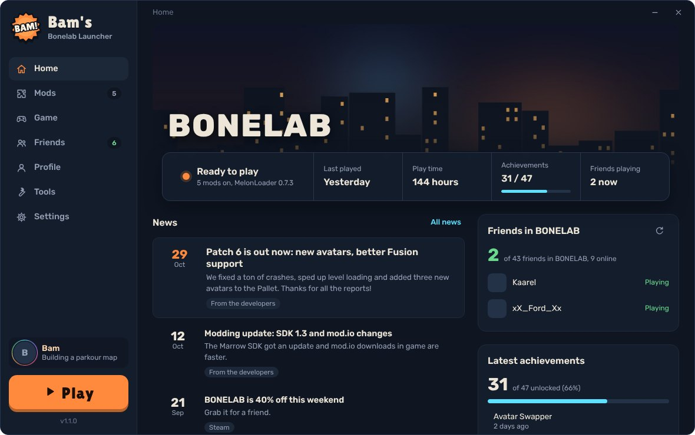
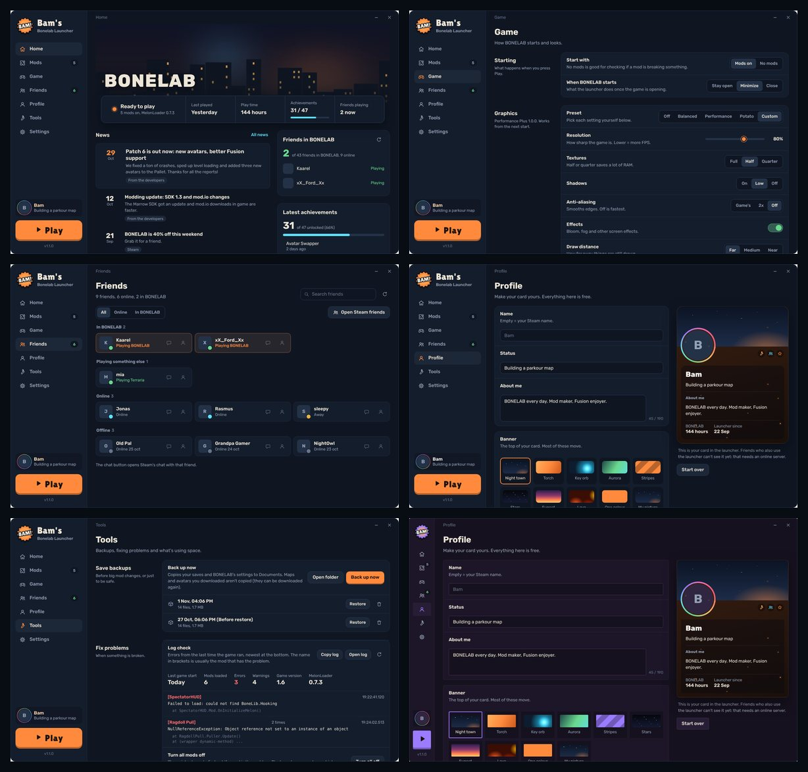

<h1 align="center">Bam's Bonelab Launcher</h1>

A casual launcher for BONELAB on PC. Play, turn mods on and off, tweak graphics, see your friends and make your own profile card.

  <a href="https://github.com/eestimuna/BamsBonelabLauncher/releases/latest"><b>⬇ Download (Windows)</b></a>
  &nbsp;·&nbsp;
  <a href="https://github.com/eestimuna/BamsBonelabLauncher/releases">All versions</a>

## Install

1. Click **Download** above, then under **Assets** click the `Bams-Bonelab-Launcher-Setup` .exe.
2. Run it. Windows may say "Windows protected your PC" because the launcher isn't from a big company: click **More info**, then **Run anyway**.
3. Click through the installer. Open it from the desktop shortcut or the Start menu.

Nothing else needed. You need BONELAB on Steam. Mods need MelonLoader.

## What's in it

- **Home:** Play (it turns into Stop while the game runs), last played, play time, achievements, friends playing right now, BONELAB news.
- **Mods:** every mod in your Mods folder with an on/off switch, so no more deleting files. Drag `.dll` or `.zip` files onto the window to add mods. "Mod settings" lets you change every mod's own settings.
- **Game:** mods on or off, graphics presets and custom graphics (with the Performance Plus mod), desktop window, MelonLoader options, launch options, BONELAB's own settings.
- **Friends:** your Steam friends and who's in BONELAB. The chat button opens Steam chat.
- **Profile:** your own card with banners (or your own GIF), frames, name styles, effects and badges. All free.
- **Tools:** back up and restore your saves, a log check that shows which mod is erroring, turn all mods off and back on, storage use.
- **Settings:** Steam account, game folder, and how the launcher looks: theme, colour, corners, animations, size.

## Achievements and friends

These need a free Steam Web API key. In the launcher go to **Settings → Steam Web API key → Get a key**, sign in, type `localhost` as the domain and press Register. Then paste the key into the launcher and press Save. Your Steam "Game details" and "Friends list" need to be Public. The key stays on your PC (encrypted by Windows).

## Uninstall

Windows Settings → Apps → Installed apps → Bam's Bonelab Launcher → Uninstall.

---

Made by Bam. Not made by or linked with Stress Level Zero or Valve.
